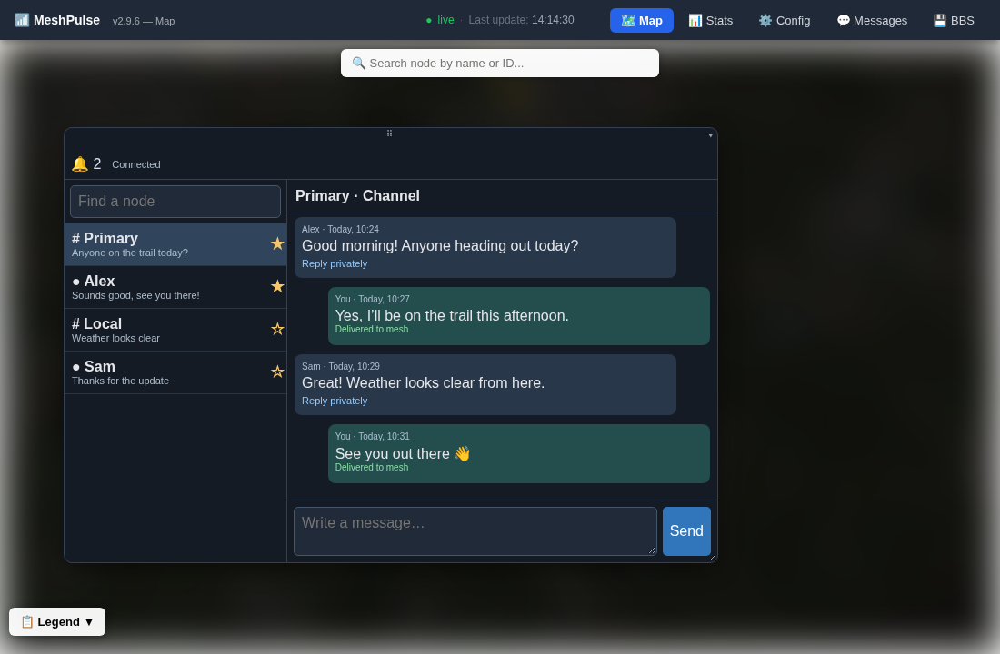

# Map Chat

Map Chat is an independent frontend plugin for [MeshPulse](https://github.com/maxg10/meshpulse),
created by Max Gieparda. It places channel and direct conversations on the map,
with pinned conversations, unread counts, drafts, an emoji picker and per-message delivery states.

*The screenshot uses fictional messages and names; the map is obscured.*

## Compatibility

**This version requires our [MeshPulse integration branch](https://github.com/vibesource/meshpulse/tree/integration/map-chat-api),
at commit `bc666cc` or a compatible descendant. It does not work with unmodified
upstream MeshPulse 2.9.6.** The branch includes the shared frontend messaging
API and delivery-state backend that Map Chat calls. We hope to contribute these
changes upstream; until then the fork's integration branch is the compatibility
target, not its unmodified `main` branch.

The plugin ID is currently `local/map-chat`, retained for compatibility with
the existing installation. It is not an official plugin from the MeshPulse
maintainer.

## Installation

From the repository root, run `./build.sh map-chat`, then upload the resulting
`dist/map-chat-0.1.9.meshplugin` using **Config → Plugins**. The plugin's
manifest must be at the archive root. For mobile, open the map layers drawer
(the map button) and scroll to Map Chat.

## Data and limitations

MeshPulse stores message history; pins, unread counts, drafts, selected
conversation and desktop panel size are stored per browser. Unread counts are not synchronized across
devices. A Submitted state indicates the local send call completed; delivery
states depend on the corresponding radio acknowledgment. A timeout does not
prove non-delivery. The plugin requires access to the MeshPulse WebSocket, and
phone access depends on a suitable HTTPS/WSS route to the host.

Map Chat has been tested with the integration branch over TCP and in an
isolated USB trial. Authentication has been tested with the live site locked and
unlocked. Hardware, connectivity and delivery outcomes vary; this is still an
early release.
